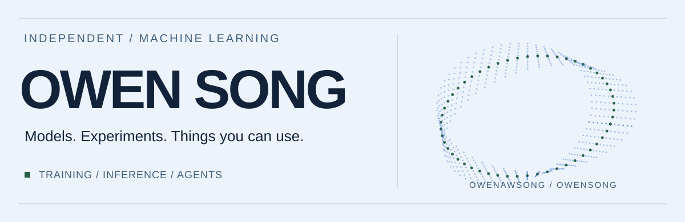

<picture>
  <source media="(prefers-color-scheme: dark)" srcset="assets/header-dark.svg">
  <source media="(prefers-color-scheme: light)" srcset="assets/header-light.svg">
  
</picture>

I work on small speech models, browser agents, and the occasional music project.
Most of my machine learning work lives on **[Hugging Face](https://huggingface.co/owensong)**.

[Models & experiments](https://huggingface.co/owensong) · [Email](mailto:owen.aw.song@gmail.com) · Discord: **blue.os**

## Selected work

### [Inflect](https://github.com/owenawsong/Inflect)
Complete text-to-speech in a small model. Nano v2 fits the full text-to-waveform path into **3.96M parameters**; Micro v2 uses **9.36M**. Both generate 24 kHz English speech locally.

**[Listen to both →](https://huggingface.co/spaces/owensong/Inflect-v2)** · [Nano weights](https://huggingface.co/owensong/Inflect-Nano-v2) · [Micro weights](https://huggingface.co/owensong/Inflect-Micro-v2) · [Code & evaluation](https://github.com/owenawsong/Inflect)

### [Sleeve](https://github.com/owenawsong/liner)
Your music taste has a history. Explore listening eras, returning favorites, and your next record through Last.fm history or a Spotify export. Free, open source, no Sleeve account required.

**[Open Sleeve →](https://liner-c7u.pages.dev/)** · [Try the demo](https://liner-c7u.pages.dev/#/demo) · [Code](https://github.com/owenawsong/liner)

### [Harbor](https://github.com/owenawsong/Harbor)
A browser agent in a Chrome extension. Give it a task and let it work through pages, forms, and tabs using the model you choose.

**[Explore Harbor →](https://github.com/owenawsong/Harbor)**

---

Also made **[Mr. Tutor](https://github.com/owenawsong/mr-tutor-discord-bot)**, a Discord tutoring bot.

Mostly Python and TypeScript. If you try something I've made, I'd like to hear how it went.
