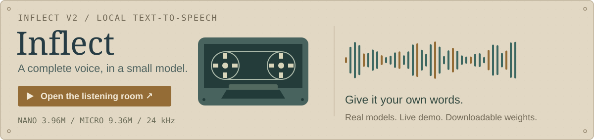
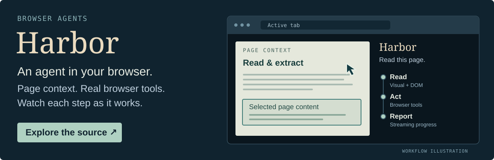
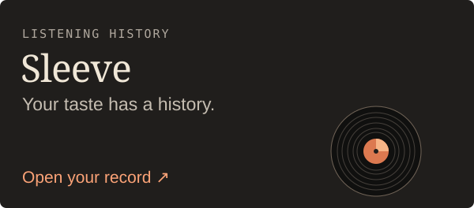
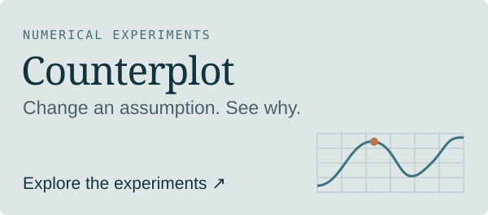
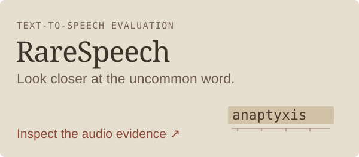

I'm Owen, a **student developer** working on machine learning and useful software. I'm interested in what smaller models can do, how to evaluate them, and what happens when you give a model tools it can actually use.

My work spans **speech models, training data, inference, and browser agents**. Most of my model releases live on [Hugging Face](https://huggingface.co/owensong); the code and apps are here.

## What I’m exploring

- **Model efficiency:** how architecture, model size and quantization affect quality and what can run locally.
- **Speech & training data:** small TTS models, synthetic datasets, and coverage beyond the easy examples.
- **Evaluation:** looking at individual failures as well as aggregate scores, with recordings and reproducible comparisons.
- **Agents & tools:** connecting models to browser interfaces and development workflows, then making their actions inspectable.

These interests connect the projects below—from training and exporting a speech model to testing the tools around it.

## Inflect · small models, complete speech

**[Inflect](https://github.com/owenawsong/Inflect)** is my compact text-to-speech project. Nano fits the complete learned text-to-waveform path into **3.96M parameters**; Micro uses **9.36M**. Both generate 24 kHz English speech locally, including the waveform decoder.

**[Try your own sentence →](https://huggingface.co/spaces/owensong/Inflect-v2)** &nbsp; · &nbsp; [Nano weights](https://huggingface.co/owensong/Inflect-Nano-v2) &nbsp; · &nbsp; [Micro weights](https://huggingface.co/owensong/Inflect-Micro-v2) &nbsp; · &nbsp; [Code & evaluation](https://github.com/owenawsong/Inflect)

<b>Give the little one a difficult sentence.</b>

Try one in the demo, or bring your own:

> At 12:07, Dr. Nguyen ordered 3.5 kilograms of oranges.

> The bass player caught a bass. Read what you've read.

> Wait—did you say fifteen, or fifty?

These are challenge prompts, not promises of a perfect reading. If something trips it up, [send the exact sentence](https://github.com/owenawsong/Inflect/issues/new).

### Models are only part of the work

- **[Synthetic speech data](https://huggingface.co/datasets/owensong/voxcpm2-synthetic-en-v1)** — **59,996 clips · 56 voices · ~112 hours**, generated with VoxCPM2. Transcripts and generation metadata are included; access terms are on the dataset card.
- **[Chatterbox Nano → ONNX](https://huggingface.co/owensong/chatterbox-nano-ONNX)** — an independent four-graph conversion with mixed precision, INT4 weights and KV-cache handling. A development release.
- **[Inflect ONNX](https://huggingface.co/owensong/Inflect-Nano-v2-ONNX)** — local inference packages for [Nano](https://huggingface.co/owensong/Inflect-Nano-v2-ONNX) and [Micro](https://huggingface.co/owensong/Inflect-Micro-v2-ONNX), alongside the PyTorch models.

<b>Under the hood: architecture, evaluation and runtime.</b>

Inflect v2 uses a compact VITS-family architecture: transformer text encoding, stochastic duration prediction, residual coupling flows and an integrated neural decoder. Parameter counts include all learned modules loaded for synthesis.

The release reports community listening, multi-ASR intelligibility, predicted naturalness, model footprint and CPU throughput separately.

[Architecture](https://github.com/owenawsong/Inflect/blob/main/docs/ARCHITECTURE.md) · [Evaluation](https://github.com/owenawsong/Inflect/blob/main/docs/EVALUATION.md) · [Deployment](https://github.com/owenawsong/Inflect/blob/main/docs/DEPLOYMENT.md)

## Harbor · an agent in your browser

**[Harbor](https://github.com/owenawsong/Harbor)** is my open-source browser agent extension. It reads the page through **visual and DOM context**, uses browser tools to act, and streams its progress into the side panel. You choose the model and provider.

<a href="https://github.com/owenawsong/Harbor"><picture><source media="(max-width: 600px)" srcset="assets/harbor-mobile-5b0bc4a1de8e.svg"></picture></a>

**See the page.** Screenshots and structured DOM context help the agent understand what's in front of it. 
**Work with the browser.** Tools for navigation, tabs, clicking, typing, forms and extracting information. 
**Follow the process.** Streaming responses and tool activity show the steps as they happen.

**[Explore Harbor →](https://github.com/owenawsong/Harbor#readme)** &nbsp; · &nbsp; [Browse the implementation](https://github.com/owenawsong/Harbor/tree/main/src)

<b>The part I'm interested in: connecting a model to a real interface.</b>

A browser agent has to work across page context, model responses, tool execution and a UI that keeps the user informed. Harbor brings these together in a TypeScript / React extension: content scripts read and interact with pages, the background coordinates requests and browser tools, and the side panel displays the conversation and tool progress.

[Page interaction](https://github.com/owenawsong/Harbor/blob/main/src/content/index.ts) · [Streaming & tool progress](https://github.com/owenawsong/Harbor/blob/main/src/sidepanel/hooks/useChat.ts)

## More things to explore

  <a href="https://liner-c7u.pages.dev/"><picture><source media="(max-width: 600px)" srcset="assets/sleeve-mobile-282b93b80a53.svg"></picture></a>
  <a href="https://owenawsong.github.io/Counterplot/"><picture><source media="(max-width: 600px)" srcset="assets/counterplot-mobile-7ab62359ad36.svg"></picture></a>

**[Sleeve](https://github.com/owenawsong/liner)** — explore listening eras, lasting favorites, changes in taste and discoveries from your music history. Bring a Last.fm profile or imported listening files. **[Open the app →](https://liner-c7u.pages.dev/)**

**[Counterplot](https://github.com/owenawsong/Counterplot)** — run parameter studies, inspect classifier errors and compare scenarios with a baseline. Export an interactive experiment as **one HTML file** someone else can explore offline. **[Try the gallery →](https://owenawsong.github.io/Counterplot/)**

  <a href="https://owenawsong.github.io/RareSpeech/"><picture><source media="(max-width: 600px)" srcset="assets/rarespeech-mobile-bc0569e43819.svg"></picture></a>
  <a href="https://github.com/owenawsong/discord-bot-kit"><picture><source media="(max-width: 600px)" srcset="assets/discord-kit-mobile-2c2b48c21027.svg"></picture></a>

**[RareSpeech](https://github.com/owenawsong/RareSpeech)** — a research toolkit for **rare-term TTS evaluation beside WER**. Fixed specialist-word tracks, target-level alignment and original recordings let you inspect what an aggregate score misses. Automatic retention is an ASR proxy; pronunciation validation is ongoing. **[Inspect the evidence →](https://owenawsong.github.io/RareSpeech/)**

**[discord-bot-kit](https://github.com/owenawsong/discord-bot-kit)** — build and test Discord bots locally. Run commands and components against the actual handlers, inspect state changes, and turn sessions into test scenarios. Includes recipes, **CLI + MCP tools** for coding agents. **[Try the ticket workflow →](https://github.com/owenawsong/discord-bot-kit#try-the-ticket-workflow)**

Mostly **Python · PyTorch · ONNX Runtime · CUDA · TypeScript · React**.

---

Tried a model, found a strange failure, or built something with one of these? I'd like to hear about it. 
<b>owen.aw.song@gmail.com</b> &nbsp; · &nbsp; Discord **blue.os**

