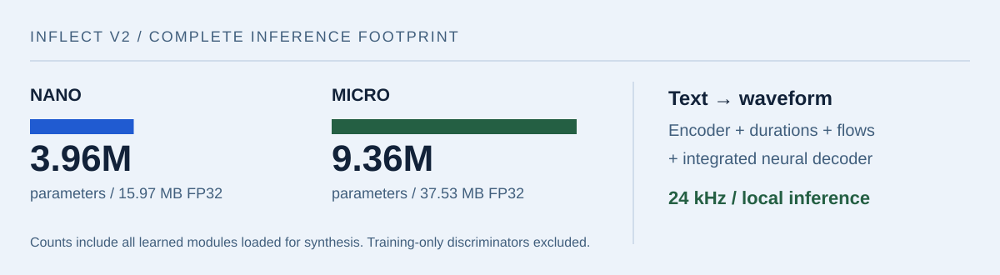

<picture>
  <source media="(prefers-color-scheme: dark)" srcset="assets/header-dark.svg">
  <source media="(prefers-color-scheme: light)" srcset="assets/header-light.svg">
  
</picture>

I build and train **machine learning models**, with a particular interest in how much useful capability can fit into a small system. My work spans training data, model evaluation, efficient inference, and AI agents.

**[Hugging Face](https://huggingface.co/owensong)** is where I publish weights, datasets, and demos. Here on GitHub, you'll find the code and applications around them.

  <a href="https://huggingface.co/owensong"><b>Models & datasets ↗</b></a> &nbsp; / &nbsp;
  <a href="mailto:owen.aw.song@gmail.com"><b>Get in touch ↗</b></a> &nbsp; / &nbsp;
  Discord: <b>blue.os</b>

## Models, data & inference

### Inflect · complete speech synthesis below 4M parameters

The question behind Inflect: **how small can a complete text-to-speech model get while remaining useful?** Nano v2 fits the entire learned text-to-waveform path into 3.96M parameters. Micro v2 uses 9.36M for more capacity. Both produce 24 kHz English speech without an external vocoder.

<a href="https://github.com/owenawsong/Inflect/blob/main/docs/ARCHITECTURE.md">
  <picture>
    <source media="(prefers-color-scheme: dark)" srcset="assets/inflect-dark.svg">
    <source media="(prefers-color-scheme: light)" srcset="assets/inflect-light.svg">
    
  </picture>
</a>

A compact VITS-family architecture with a transformer text encoder, stochastic duration prediction, residual coupling flows, and an integrated waveform decoder. The releases include **PyTorch and ONNX runtimes**, held-out evaluation, and downloadable checkpoints.

**[Listen to Nano & Micro →](https://huggingface.co/spaces/owensong/Inflect-v2)** · [Source](https://github.com/owenawsong/Inflect) · [Architecture](https://github.com/owenawsong/Inflect/blob/main/docs/ARCHITECTURE.md) · [Evaluation](https://github.com/owenawsong/Inflect/blob/main/docs/EVALUATION.md)

### Beyond the checkpoint

| Work | What I published |
| :--- | :--- |
| **Synthetic training data** | [VoxCPM2 Synthetic English](https://huggingface.co/datasets/owensong/voxcpm2-synthetic-en-v1): **59,996 clips · 56 voices · ~112 hours**, with transcripts and generation metadata. Synthetic audio generated using VoxCPM2; access terms are on the dataset card. |
| **Model conversion & quantization** | [Chatterbox Nano ONNX](https://huggingface.co/owensong/chatterbox-nano-ONNX): an independent four-graph conversion with mixed precision, INT4 weights, and KV-cache handling. A working development conversion, with broader evaluation still pending. |
| **Local inference** | [Nano ONNX](https://huggingface.co/owensong/Inflect-Nano-v2-ONNX) and [Micro ONNX](https://huggingface.co/owensong/Inflect-Micro-v2-ONNX), alongside the [PyTorch releases](https://huggingface.co/owensong). |
| **Evaluation & reproducibility** | [Inflect evaluation](https://github.com/owenawsong/Inflect/blob/main/docs/EVALUATION.md): community listening, multi-ASR intelligibility, predicted naturalness, footprint, and measured CPU throughput. |

## Applied AI & other builds

<picture>
    <source media="(prefers-color-scheme: dark)" srcset="assets/projects-dark.svg">
    <source media="(prefers-color-scheme: light)" srcset="assets/projects-light.svg">
    
</picture>

**[Harbor](https://github.com/owenawsong/Harbor)** — a browser agent packaged as a Chrome extension. Visual and DOM context, browser tools, streaming progress, and a choice of model providers.

**[Sleeve](https://github.com/owenawsong/liner)** — a music-history explorer built around Last.fm and Spotify exports. Listening eras, changes in taste, recommendations, and optional AI notes. **[Open the app →](https://liner-c7u.pages.dev/)**

**[Mr. Tutor](https://github.com/owenawsong/mr-tutor-discord-bot)** — an AI tutoring bot for Discord.

---

**Tools I work with:** `Python` · `PyTorch` · `ONNX Runtime` · `CUDA` · `TypeScript` · `React`

For questions, feedback, or collaborations: **[owen.aw.song@gmail.com](mailto:owen.aw.song@gmail.com)** · Discord **blue.os**
