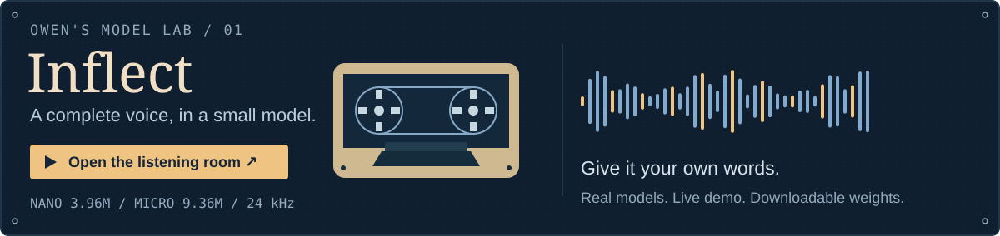
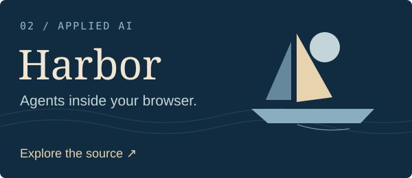
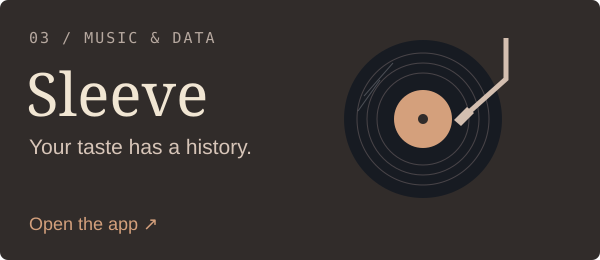

I'm Owen, a **student developer** interested in machine learning, efficient AI, and building useful software. My projects include small speech models, inference experiments, browser agents, and music stats.

Most of my ML releases live on **[Hugging Face](https://huggingface.co/owensong)**. You'll find the code and apps here.

[Hugging Face ↗](https://huggingface.co/owensong) &nbsp; · &nbsp; [Email ↗](mailto:owen.aw.song@gmail.com) &nbsp; · &nbsp; Discord **blue.os**

## A small model you can actually listen to

**[Inflect](https://github.com/owenawsong/Inflect)** is my compact text-to-speech project. Nano fits the whole learned text-to-waveform path into **3.96M parameters**. Micro uses **9.36M**. Both make 24 kHz English speech locally, including the waveform decoder.

**[Try both voices →](https://huggingface.co/spaces/owensong/Inflect-v2)** &nbsp; · &nbsp; [Weights](https://huggingface.co/owensong) &nbsp; · &nbsp; [Code & results](https://github.com/owenawsong/Inflect)

<b>Give the little one a difficult sentence.</b>

Try one in the demo, or bring your own:

> At 12:07, Dr. Nguyen ordered 3.5 kilograms of oranges.

> The bass player caught a bass. Read what you've read.

> Wait—did you say fifteen, or fifty?

The demo runs Nano and Micro on your text. These are challenge prompts, not claims that every reading is correct. If a sentence trips it up, [send the exact text](https://github.com/owenawsong/Inflect/issues/new).

### More from the model lab

- **[Synthetic speech data](https://huggingface.co/datasets/owensong/voxcpm2-synthetic-en-v1)** — **59,996 clips, 56 voices, ~112 hours** generated with VoxCPM2, with transcripts and generation metadata. Access terms are on the dataset card.
- **[Chatterbox Nano → ONNX](https://huggingface.co/owensong/chatterbox-nano-ONNX)** — an independent four-graph conversion with mixed precision, INT4 weights, and KV-cache handling. Development release.
- **[Inflect ONNX releases](https://huggingface.co/owensong/Inflect-Nano-v2-ONNX)** — local inference packages alongside the PyTorch models.

<b>Under the hood: architecture, evaluation, and runtime.</b>

Inflect v2 uses a compact VITS-family architecture: transformer text encoding, stochastic duration prediction, residual coupling flows, and an integrated neural decoder. The parameter counts include all learned modules loaded for synthesis.

The release reports community listening, multi-ASR intelligibility, predicted naturalness, footprint, and CPU throughput separately.

[Architecture](https://github.com/owenawsong/Inflect/blob/main/docs/ARCHITECTURE.md) · [Evaluation](https://github.com/owenawsong/Inflect/blob/main/docs/EVALUATION.md) · [Deployment](https://github.com/owenawsong/Inflect/blob/main/docs/DEPLOYMENT.md) · [Micro ONNX](https://huggingface.co/owensong/Inflect-Micro-v2-ONNX)

## Other things I've made

  
  

**[Harbor](https://github.com/owenawsong/Harbor)** — browser agents with visual and DOM context, browser tools, streaming progress, and your choice of model.

**[Sleeve](https://github.com/owenawsong/liner)** — a music-history explorer: listening eras, changing taste, discoveries, and a next record to try. **[Open it →](https://liner-c7u.pages.dev/)**

Also: **[Mr. Tutor](https://github.com/owenawsong/mr-tutor-discord-bot)**, an AI tutoring bot for Discord.

---

Mostly **Python, PyTorch, ONNX Runtime, CUDA, TypeScript, and React**.

Tried something I've made? I'd like to hear how it went.  
**[owen.aw.song@gmail.com](mailto:owen.aw.song@gmail.com)** · Discord **blue.os**
